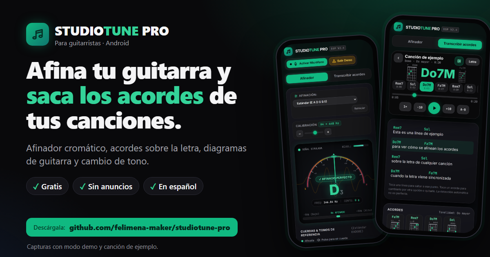
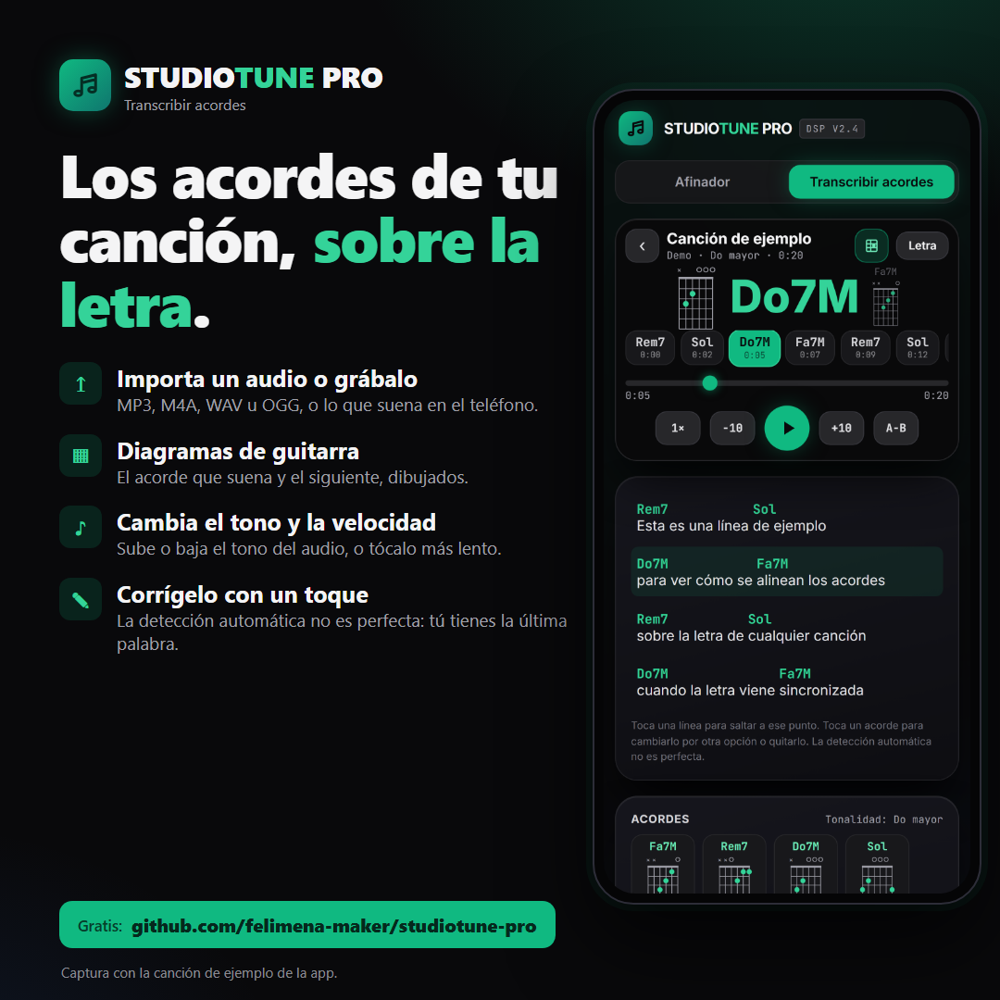
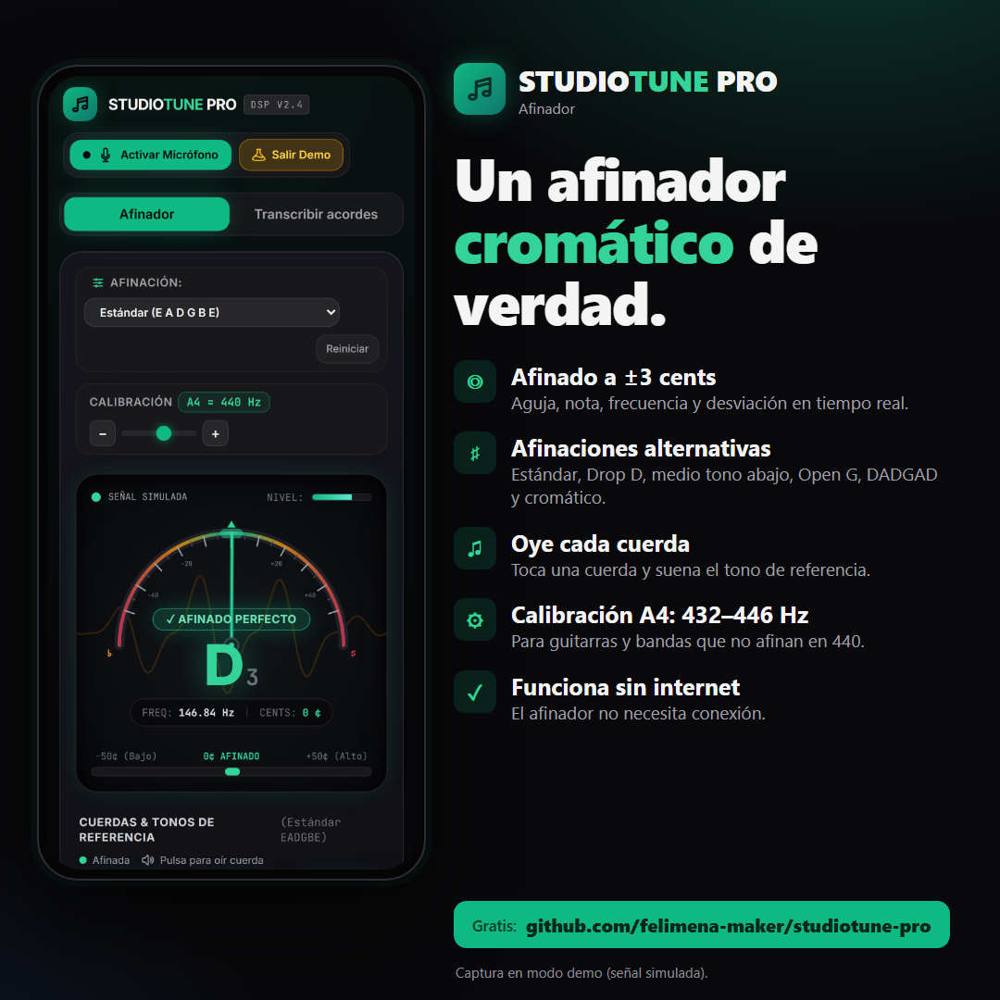

# StudioTune Pro

App Android (Capacitor) con dos herramientas para guitarristas:

- **Afinador cromático** de alta precisión (autocorrelación, calibración A4, afinaciones alternativas).
- **Transcribir acordes**, estilo reproductor: importa un archivo de audio o graba lo que suena en el teléfono, detecta los
  acordes, los coloca sobre la letra sincronizada (LRCLIB), muestra diagramas de guitarra, y permite cambiar el tono y la
  velocidad del audio.

Todo el procesamiento de audio ocurre en el teléfono. Solo se usa internet para buscar la letra (LRCLIB) y leer el título de
un enlace de YouTube/Spotify. La app **no descarga audio de YouTube ni de Spotify**.

<p align="center">
  
</p>

### [⬇ Descargar la última versión (APK)](https://github.com/felimena-maker/studiotune-pro/releases/latest)

Gratis y sin anuncios. Requiere **Android 8 o superior** (la captura de «Audio del teléfono» requiere Android 10 o superior).

## Instalación

1. Descarga `StudioTunePro-1.0.apk` desde [Releases](https://github.com/felimena-maker/studiotune-pro/releases/latest).
2. Ábrelo en el teléfono. Android pedirá permitir instalar apps desde esa fuente, porque la app no está en Google Play.
3. Al abrirla, concede los permisos que te pida cuando uses cada función:
   - **Micrófono**, para el afinador y para grabar con el micrófono.
   - **Captura de audio** (solo «Audio del teléfono»): Android muestra su diálogo estándar de grabación; la app solo toma el audio, nunca la pantalla. Algunas apps de música o vídeo bloquean esta captura: entonces usa el micrófono.
   - **Notificaciones**, para el aviso mientras graba en segundo plano.

## Qué hace

- **Afinador cromático**: aguja, nota, frecuencia y cents en tiempo real; afinaciones estándar, Drop D, medio tono abajo, Open G, DADGAD y cromático; tonos de referencia; calibración A4 de 432 a 446 Hz. No necesita internet.
- **Transcribir acordes**: importa un archivo de audio (MP3, M4A, WAV, OGG) o graba lo que suena, también con la app en segundo plano. Los acordes (mayores, menores y con séptima) se colocan sobre la letra sincronizada, con diagramas de guitarra.
- **Reproductor**: acorde actual y siguiente, tira de acordes, velocidad 0.5×–1.25×, repetición de un tramo, cambio de tono del audio y transposición, biblioteca con las canciones guardadas.

<p align="center">
  
  
</p>

## Privacidad y límites

- El audio se analiza **en el teléfono**; no se sube a ningún servidor. Solo se usa internet para buscar la letra en [LRCLIB](https://lrclib.net) y, si pegas un enlace de YouTube o Spotify, para leer el título. **No descarga audio** de YouTube ni de Spotify.
- La detección automática de acordes **no es perfecta**: con voz y batería fuertes puede fallar. Cada acorde se puede corregir tocándolo.
- Las capturas de las imágenes usan el modo demo y la canción de ejemplo de la app.

## Estructura

| Ruta | Contenido |
|---|---|
| `src/index.html` | Interfaz (Tailwind) |
| `src/chords.js` | Motor de acordes: picos espectrales, afinación, plantillas, Viterbi, alineación con la letra |
| `src/pcm.js` | FFT y análisis de una grabación completa |
| `src/shapes.js` | Posiciones de guitarra y dibujo SVG |
| `src/pitch.entry.mjs` | Cambio de tono con SoundTouch (se empaqueta con esbuild) |
| `src/transcribe.js` | Pantallas de biblioteca, añadir canción y reproductor |
| `android/app/src/main/java/com/studiotune/pro/` | Servicio de captura en segundo plano (`CaptureService`) y plugin (`AudioCapturePlugin`) |
| `test/` | Pruebas del motor con audio sintético (`node test/chords.test.js`, `shapes.test.js`, `pcm.test.js`, `bench.js`) |

## Compilar

Requisitos: Node 20+, JDK 17 y Android SDK (`android/local.properties` con `sdk.dir=...`).

```bash
npm install
npm run build:web          # genera www/ (CSS, fuentes, SoundTouch)
npx cap sync android
cd android
./gradlew assembleDebug    # APK de depuración
```

Para un APK `release` firmado, crea tu propia clave y un `signing/keystore.properties` con `storeFile`, `storePassword`,
`keyAlias` y `keyPassword` (esa carpeta está en `.gitignore` y no debe subirse nunca).

## Pruebas

```bash
node test/chords.test.js
node test/shapes.test.js
node test/pcm.test.js
node test/pitch.test.mjs
node test/bench.js        # banco con canciones sintéticas difíciles (tarda unos minutos)
```

## Límites conocidos

- Con grabaciones reales con voz y batería la detección no es perfecta: se pueden corregir los acordes tocándolos.
- La captura de «Audio del teléfono» depende de que la app que reproduce permita ser capturada.
- Las pruebas de precisión usan audio sintético y no garantizan el resultado con canciones reales.

## Licencias

Cambio de tono: [SoundTouchJS](https://github.com/cutterbl/SoundTouchJS) (LGPL-2.1). Fuentes Inter y JetBrains Mono (OFL).
Letras: [LRCLIB](https://lrclib.net).
